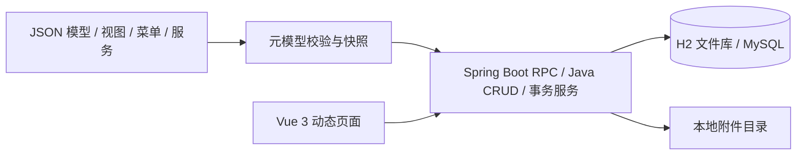

# 元构：模型驱动开发低代码平台

元构是一个以 JSON 元模型驱动业务数据、页面和服务的实训项目。开发者定义模型、视图、菜单和事务服务，平台校验配置并生成通用 CRUD 接口和操作页面；需要专用业务逻辑时，可为指定模型注册 Java 处理类。

项目后端使用 Java 17、Spring Boot 和 JDBC，前端使用 Vue 3 与 Element Plus。默认使用本地 H2 文件数据库，支持 MySQL，不依赖 Redis 或 MQ。

## 功能概览

- **JSON 建模**：定义模型字段、校验约束、引用关系和状态机；按应用配置列表、表单、菜单、查询和业务按钮，支持热重载。
- **Java CRUD 扩展**：按模型重写需要的 CRUD 操作；其他操作继续使用通用实现。当前学生处理类会去掉姓名两端空白，示例见 [`StudentCrudHandler.java`](platform-server/src/main/java/com/platform/custom/StudentCrudHandler.java)。
- **用户和权限**：账号、角色、应用授权、行级数据范围、服务端鉴权、审计，以及用户逻辑删除。
- **生产示例**：BOM 版本、按 BOM 建工单、领料、装配、用料核销、齐套检查和 BOM 工单余料退库。
- **质量与追溯**：不良隔离、冻结、返工更换、复检、历史关联、附件、质量图表和整机首次检验直通率。
- **事务服务与日志**：通过 JSON 编排事务步骤、条件和幂等键；提供嵌套调用链及服务执行日志。
- **后端批量接口**：同一模型的批量新增、删除，每批 1～200 条，整批提交或回滚。页面操作以单条记录为单位。

## 技术结构



## 本机快速启动

需要 JDK 17、Node.js 20.19+ 或 22.12+，以及 Windows PowerShell。Maven 使用项目附带的启动脚本。

在项目根目录执行：

```powershell
.\build.ps1
.\start.ps1
```

首次构建会安装前端依赖、构建静态页面并运行 Maven 验证。启动后访问 [http://127.0.0.1:8080](http://127.0.0.1:8080)。停止服务可运行 `.\stop.ps1`；如果在前台启动，按 `Ctrl+C` 即可。

首次启动会创建管理员账号 `admin`，随机初始密码写入 `.logs/admin-initial-password.txt`。登录后必须修改初始密码。不要将密码文件、数据库文件或附件目录提交到代码仓库。

默认数据库保存在项目的 `data/` 目录，元模型保存在 `meta/`，上传附件默认保存在 `uploads/`。首次启动示例数据只在空库中初始化，不会覆盖现有业务记录。

## 使用 IDEA 启动

1. 先在项目根目录运行 `.\build.ps1`，构建前端并准备后端静态资源。
2. 在 IDEA 中打开 `platform-server/pom.xml` 并导入 Maven 项目。
3. 运行 `com.platform.PlatformApplication`，工作目录设为项目的 `platform-server`。
4. 浏览器打开 `http://127.0.0.1:8080`。

如果只修改 Java 处理类，需要重新编译并重启后端。点击“重载元模型”只会重新加载 JSON 配置。

## 前后端分开开发

后端终端：

```powershell
cd platform-server
..\mvnw.cmd spring-boot:run
```

另开终端启动前端：

```powershell
cd platform-web
npm.cmd ci
npm.cmd run dev
```

开发页面地址为 `http://127.0.0.1:5173`。Vite 会把 `/rpc` 和 `/api` 请求代理到 `http://127.0.0.1:8080`。

## 建模与 Java 扩展

模型保存在 `meta/models/`，视图按应用保存在 `meta/views/`，菜单统一保存在 `meta/menus/main.json`，事务服务保存在 `meta/services/`。新增配置后，通过平台的“重载元模型”使其生效。校验失败会保留当前运行版本。

若要为一个模型增加 Java 逻辑，创建继承 `ModelCrudHandler` 的 Spring 组件，通过 `modelCode()` 绑定模型，并重写所需操作。调用 `super.create(...)` 或 `context.proceed(...)` 可继续使用平台通用校验和保存逻辑。完整配置步骤和接口示例见[建模与运行指南](docs/04-建模与运行指南.md)。

## 测试与验收

```powershell
# 后端自动化测试
.\mvnw.cmd -f .\platform-server\pom.xml test -B -ntp

# 前端类型检查和生产构建
npm.cmd --prefix .\platform-web run build

# 可选：MySQL 专项测试，需先配置专用测试库
if (-not (Test-Path .\.env.mysql-test)) { Copy-Item .\.env.mysql-test.example .\.env.mysql-test }
.\scripts\test-mysql.ps1
```

MySQL 配置只填写在本地 `.env.mysql-test` 中，使用专用测试库，不要指向生产或业务数据库。配置模板已加入版本管理，实际凭据文件已由 `.gitignore` 排除。

| 文档 | 内容 |
| --- | --- |
| [需求分析](docs/01-需求分析文档.md) | 项目目标、功能需求和验收标准 |
| [可行性分析](docs/02-项目可行性分析报告.md) | 技术与项目可行性 |
| [项目设计](docs/03-项目设计文档.md) | 架构、接口、存储及核心流程 |
| [建模与运行指南](docs/04-建模与运行指南.md) | 建模、启动和业务操作方法 |
| [交付与验收记录](docs/05-迭代交付与验收记录.md) | 当前实现及测试证据 |
| [完整功能验收清单](docs/06-完整功能验收清单.md) | 页面和业务流程检查步骤 |
| [视频演示脚本](docs/07-视频演示脚本.md) | 演示顺序与讲解建议 |
| [收尾任务清单](docs/08-收尾任务清单.md) | 最终验收、备份和交付准备 |

## 目录结构

```text
platform-server/   Java 后端、REST/RPC 接口和自动化测试
platform-web/      Vue 3 前端
meta/models/       业务模型定义
meta/views/        按应用划分的页面定义
meta/menus/        菜单定义
meta/services/     事务服务定义
meta/demo/         空库示例数据
meta/backfills/    启动时的增量数据回填
docs/              需求、设计、使用与验收文档
scripts/           Maven、冒烟和 MySQL 测试辅助脚本
```

## 当前范围

当前实现适用于本地开发、实训和演示。通用前端批量操作入口、批量更新、多租户、多层 BOM、替代料、工程变更审批、复杂级联、对象存储、通用工作流及生产级多实例容量保障不属于当前交付范围。学生、工单和附件等数据需按数据库与附件目录进行配套备份；H2 备份前先停止服务。
