# 模型驱动开发（MDD）低代码平台 —— 项目设计文档

| 项目名称 | 模型驱动开发低代码平台 |
| -------- | --------------------- |
| 文档版本 | V1.0 |
| 编写日期 | 2026-11-15 |
| 文档状态 | 初稿（待评审） |
| 上游文档 | 《需求分析文档》《可行性分析报告》 |

> 本文档包括概要设计、详细设计以及业务与平台服务设计，覆盖总体架构、模块、接口、数据存储、核心流程和业务协议。UML 图采用 Mermaid 表述。

---

# 第一部分 概要设计

## 1. 引言

### 1.1 编写目的

依据《需求分析文档》完成系统的总体设计与详细设计，作为编码实现的直接依据。预期读者：开发人员、测试人员。

### 1.2 设计原则

1. **元数据驱动**：模型、接口、页面的业务表达全部由元模型描述，运行时解释执行；
2. **约定优于配置**：服务命名 `<model>.<action>`、审计字段、表名 `t_<code>` 等提供默认约定；
3. **白名单安全**：字段、操作符、排序仅从元模型白名单匹配，SQL 全参数化；
4. **快照一致性**：元模型以不可变快照整体原子替换，请求全程持有同一快照；
5. **扩展点前置**：鉴权、聚合与模型 Java 处理类按职责分离；数据库同步支持 H2 与 MySQL；
6. **服务亦为元模型**：服务定义与模型、视图一样由 JSON 声明，参与同一套加载、校验与快照替换，通用业务采用 JSON 编排，专用算法通过模型 Java 处理类扩展；
7. **场景抽象化**：业务异常流（不良品、返工、追溯、并发）沉淀为平台通用能力，不在上层系统硬编码。

### 1.3 系统总体架构

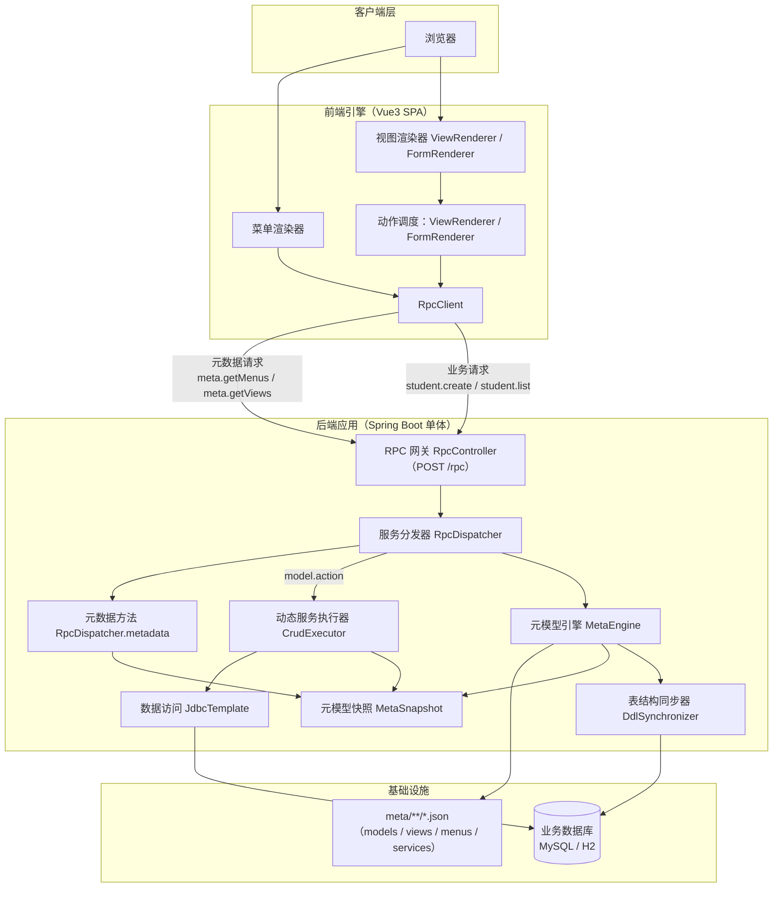

**三类前后端交互契约**（与需求分析文档 2.4 节呼应）：

| 交互 | 方法（JSONRPC） | 用途 |
| ---- | --------------- | ---- |
| 元数据请求 | `meta.*` | 获取菜单树、视图定义、模型定义、触发热重载 |
| 标准业务请求 | `<modelCode>.<action>` | 模型数据的增删改查 |
| 自定义服务请求 | `service.<服务编码>` | 事务编排类业务能力，见 §18 |

### 1.4 技术选型

| 层面 | 选型 | 版本 / 来源 | 说明 |
| ---- | ---- | -------- | ---- |
| 语言/框架 | Java / Spring Boot | 17 / 3.5.7 | Web、依赖注入、配置 |
| JSON 处理 | Jackson | 由 Spring Boot 管理 | 序列化/反序列化、JsonNode 处理 params |
| 元模型校验 | Jackson JsonNode / MetaEngine | 由 Spring Boot 管理 Jackson 版本 | JSON 解析、结构校验和跨定义语义校验 |
| 数据访问 | Spring JDBC（JdbcTemplate） | 随 Boot | 动态 SQL 场景比 ORM 更可控 |
| 连接池 | HikariCP | 随 Boot | 默认连接池 |
| 数据库 | MySQL（生产）/ H2（开发测试） | 8.x / 2.x | DdlSynchronizer 内置两种数据库的结构映射与兼容检查 |
| ID 生成 | 自增 / 雪花 / UUID | — | CrudExecutor 按模型 idType 选择生成方式 |
| 前端框架 | Vue 3 + Element Plus + Vite | package.json 声明 3.5+ / 2.9+ / 6.2+ | 动态组件渲染 |
| 前端路由 | Vue Router（`addRoute` 动态注册） | 4.x | 由菜单元模型动态生成路由表，不硬编码路由配置 |
| 前端状态 | Pinia | package.json 声明 3.0+ | 元数据缓存 |
| 构建/部署 | Maven / Docker | — | 单 jar 部署 + 前端静态资源 |

## 2. 系统模块组织结构图

```mermaid
flowchart TD
    ROOT["模型驱动低代码平台"]
    ROOT --> BE["后端子系统 platform-server"]
    ROOT --> FE["前端引擎子系统 platform-web"]

    BE --> MOD_META["meta 元模型模块"]
    BE --> MOD_RPC["rpc 网关模块"]
    BE --> MOD_SVC["service 动态服务模块"]
    BE --> MOD_DAO["dao 数据访问模块"]

    MOD_META --> META_LOADER["MetaEngine.load：文件扫描与 JSON 解析"]
    MOD_META --> META_VALIDATOR["MetaEngine：结构与语义校验"]
    MOD_META --> META_REPO["MetaEngine.current / MetaSnapshot"]
    MOD_META --> META_MODEL["JsonNode：模型、字段、菜单和视图节点"]

    MOD_RPC --> RPC_WEB["web：RpcController（POST /rpc）"]
    MOD_RPC --> RPC_DISP["RpcDispatcher：按方法前缀分发"]
    MOD_RPC --> RPC_ERR["error：错误码体系"]

    MOD_SVC --> SVC_EXEC["executor：CrudExecutor（CRUD 编排）"]
    MOD_SVC --> SVC_VALID["CrudExecutor：参数与记录校验"]
    MOD_SVC --> SVC_META["RpcDispatcher.metadata：元数据方法"]

    MOD_DAO --> DAO_SQL["CrudExecutor：过滤、排序与参数化 SQL"]
    MOD_DAO --> DAO_DDL["DdlSynchronizer：同步与结构兼容检查"]
    MOD_DAO --> DAO_ID["CrudExecutor：主键生成"]

    FE --> FE_API["api.ts：rpc 函数"]
    FE --> FE_STORE["store：MetaStore（元数据缓存）"]
    FE --> FE_RENDER["render：菜单/列表/表单渲染"]
    FE --> FE_WIDGET["widgets：动态控件库"]
    FE --> FE_ACTION["ViewRenderer / FormRenderer：按钮动作"]
```

## 3. 分析类图（OOA 概念模型）

> 概念层类图，表达领域概念及其关系；类名与中文含义对照见各图下方表。概念节点不代表同名源码文件：模型、字段、菜单、视图及服务内容保存为 MetaSnapshot 中的 JsonNode；业务执行对应 CrudExecutor、ServiceOrchestrator，前端引擎对应 App.vue、ViewRenderer.vue 和 FormRenderer.vue。实际包和类见 §8～§10。

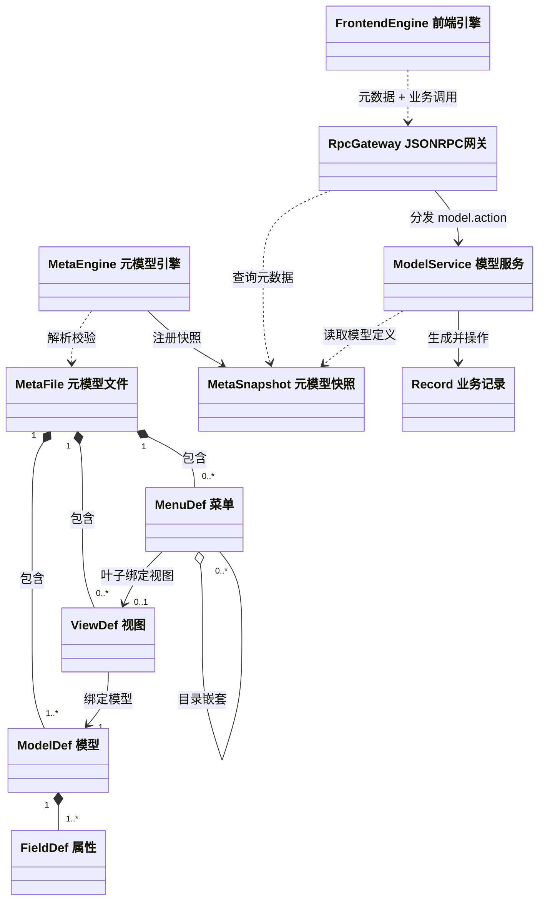

| 类 | 中文含义 | 说明 |
| -- | -------- | ---- |
| MetaFile | 元模型文件 | `meta/` 目录下的 JSON 文件，平台的业务输入 |
| ModelDef / FieldDef | 模型 / 属性 | 业务实体的声明式定义 |
| MenuDef / ViewDef | 菜单 / 视图 | 导航与页面（列表、表单）的声明式定义 |
| MetaEngine | 元模型引擎 | 加载 → 校验 → 注册 → 表同步 |
| MetaSnapshot | 元模型快照 | 内存快照，运行期元数据唯一来源 |
| RpcGateway | JSONRPC 网关 | 统一入口，method 路由分发 |
| ModelService | 模型服务 | 由模型定义动态赋予的 CRUD 能力 |
| Record | 业务记录 | 业务表中的一行数据 |
| FrontendEngine | 前端引擎 | 元数据渲染 + 动作调度 |

## 4. 接口概要设计

统一入口：`POST /rpc`，请求/响应遵循 JSONRPC 2.0。

### 4.1 方法清单

| method | 类别 | params 摘要 | result / 说明 |
| ------ | ---- | ----------- | ------------- |
| `meta.getMenus` | 元数据 | 无 | 完整菜单树（已排序） |
| `meta.getViews` | 元数据 | `{ "codes": ["student_list", ...] }` | 视图定义数组 |
| `meta.getModel` | 元数据 | `{ "code": "student" }` | 模型定义（属性/约束/枚举） |
| `meta.reload` | 管理 | 无 | 重载成功返回新版本号；失败返回 -32005 + 错误清单 |
| `meta.status` | 管理 | 无 | 已加载模型/视图/菜单/服务清单及版本 |
| `service.<服务编码>` | 自定义服务 | 由服务定义的 `params` 声明 | 事务编排执行结果，见 §18 |
| `{model}.create` | 业务 | 数据键值对（仅 editable 字段） | 含 id 的完整记录 |
| `{model}.read` | 业务 | `{ "id": 1 }` | 单条记录 |
| `{model}.update` | 业务 | `{ "id": 1, "version": 0, ...待更新字段 }` | 更新后的记录 |
| `{model}.delete` | 业务 | `{ "id": 1, "version": 0 }` | 逻辑删除，返回 `{ "id": 1 }` |
| `{model}.list` | 业务 | `{ page, pageSize, sortField, order, filters[] }` | `{ total, records }` |
| `{model}.batchCreate` | 后端业务接口 | `{ "records": [{...字段值}, ...] }`，1～200 条 | `{ "records": [...完整记录] }`；整批事务 |
| `{model}.batchDelete` | 后端业务接口 | `{ "records": [{ "id": 1, "version": 0 }, ...] }`，1～200 条 | `{ "records": [{ "id": 1 }, ...] }`；整批事务 |

### 4.2 过滤条件协议（list.filters）

| 操作符 | 含义 | 值形式 | 前提 |
| ------ | ---- | ------ | ---- |
| eq / ne | 等于 / 不等于 | 单值 | 字段 searchable |
| like | 模糊 | 单值 | 字段 searchable |
| gt / ge / lt / le | 比较 | 单值 | 字段 searchable |
| in | 包含 | 数组 | 字段 searchable |
| between | 区间 | 两元素数组 | 字段 searchable |

非法字段、非法操作符一律拒绝（-32602），不降级处理。

### 4.3 错误码表

| code | 含义 | data 说明 |
| ---- | ---- | --------- |
| -32700 | JSON 解析错误 | 原始错误摘要 |
| -32600 | 无效请求（协议字段缺失等） | — |
| -32601 | 方法不存在 | 可用方法提示 |
| -32602 | 参数无效（含过滤条件非法） | 字段级明细 |
| -32603 | 服务器内部错误 | — |
| -32001 | 数据校验失败 | `{ "fields": [{ "code", "message" }] }` |
| -32002 | 记录不存在 | `{ "id" }` |
| -32003 | 唯一约束冲突 | `{ "fields": [...] }` |
| -32004 | 元数据不存在（视图/模型） | `{ "code" }` |
| -32005 | 元模型重载校验失败 | `{ "errors": [{ "file", "path", "message" }] }` |
| -32006 | 乐观锁版本冲突 | 刷新记录后重新提交 |
| -32010 | 服务编排执行失败 | `{ "step", "cause" }` |
| -32011 | 前置守卫拒绝 | `{ "guard", "message" }` |
| -32012 | 幂等键并发冲突 | `{ "key" }` |
| -32013 | 非法状态转移 | `{ "from", "to", "allowed" }` |
| -32021 | 操作权限不足 | — |

### 4.4 批量接口与事务边界

模型批量接口操作同一模型下的业务记录。`batchCreate` 的每项为单条新增参数，`batchDelete` 的每项必须携带记录 `id` 与当前 `version`。通用执行器在一个写事务中逐条进入该模型的 `create` 或 `delete` 入口，执行已注册的 Java 处理类及通用校验；任一条失败时整批回滚并返回错误，不返回逐条部分成功结果。删除方式遵循模型的逻辑删除配置，数据范围、版本和只追加约束继续生效。

JSONRPC 请求数组属于协议层批量调用：数组包含 1～200 个完整请求，控制器按请求分别执行鉴权、分发和错误处理，各请求不共享一个自动建立的批量事务。某项失败不撤销其他已完成请求；通知不产生响应项。需要多个业务步骤共同提交或回滚时，使用模型批量接口或显式的事务服务。

幂等由 JSON 服务显式声明 `idempotencyKey` 后提供；通用 `batchCreate`、`batchDelete` 不自动去重。列表勾选用于选中状态与数量展示，通用前端批量操作入口、批量更新、逐条部分成功和专用扫码录入界面不属于交付范围。

## 5. 数据库概要设计

### 5.1 存储划分

| 数据 | 存储位置 | 说明 |
| ---- | -------- | ---- |
| 元模型 | 文件系统 `meta/` 目录 + 内存快照 | 不入库，纳入 Git 版本管理 |
| 业务数据 | 业务数据库 | 表结构由 DdlSynchronizer 按模型定义自动维护 |

### 5.2 业务表统一规范

| 列 | 类型 | 说明 |
| -- | ---- | ---- |
| id | BIGINT / VARCHAR(64) | 主键，随 idType 策略 |
| …业务列… | 见类型映射表 | 由模型属性生成 |
| version | BIGINT | 乐观锁版本，非空，初始为 0 |
| created_by | VARCHAR(64) | 服务端记录创建账号 |
| created_at | TIMESTAMP | 创建时间，默认数据库当前时间 |
| updated_by | VARCHAR(64) | 服务端记录最近修改账号 |
| updated_at | TIMESTAMP | 最近修改时间 |
| deleted | BOOLEAN | 逻辑删除标记，初始为 FALSE；logicDelete=false 时不建 |

### 5.3 字段类型 → SQL 类型映射（封闭矩阵）

| 元模型 type | SQL 类型 | 备注 |
| ----------- | -------- | ---- |
| string(length) | VARCHAR(length) | 缺省 length=255 |
| text | TEXT | |
| integer | BIGINT | |
| decimal(p,s) | DECIMAL(p,s) | 缺省 (18,2) |
| boolean | BOOLEAN | 由数据库驱动返回布尔类型 |
| date | DATE | |
| datetime | TIMESTAMP | |
| enum | VARCHAR(100) | 存 option value |
| ref | BIGINT / VARCHAR(64) | 目标使用 UUID 时为 VARCHAR(64)，否则为 BIGINT |

### 5.4 索引与约束策略

| 对象 | 策略 |
| ---- | ---- |
| 主键 | id 主键（自增模型由数据库生成；雪花/UUID 由应用生成） |
| unique 属性 | 应用层预检（-32003）+ 数据库唯一索引兜底 |
| deleted | 逻辑删除模型的查询过滤该列，不自动为其单独建索引 |
| searchable 高频字段 | 由建模人员在模型 JSON 中显式声明 `index: true` 才建索引 |

### 5.5 示例 DDL（student 模型）

```sql
CREATE TABLE t_student (
  id          BIGINT       PRIMARY KEY AUTO_INCREMENT,
  studentNo   VARCHAR(30)  NOT NULL,
  name        VARCHAR(50)  NOT NULL,
  gender      VARCHAR(100),
  age         BIGINT,
  enrollDate  DATE,
  remark      TEXT,
  version     BIGINT       NOT NULL DEFAULT 0,
  created_at  TIMESTAMP    NOT NULL DEFAULT CURRENT_TIMESTAMP,
  updated_at  TIMESTAMP    NOT NULL DEFAULT CURRENT_TIMESTAMP,
  created_by  VARCHAR(64)  DEFAULT 'demo',
  updated_by  VARCHAR(64)  DEFAULT 'demo',
  deleted     BOOLEAN      NOT NULL DEFAULT FALSE
);
CREATE UNIQUE INDEX ux_t_student_studentNo ON t_student(studentNo);
CREATE INDEX ix_t_student_created_by ON t_student(created_by);
```

字段名沿用模型编码，不执行驼峰转下划线转换。学号唯一，姓名允许重复；创建人索引用于该模型的本人数据范围过滤。应用写入时以实际操作者覆盖审计账号。

## 6. 运行与部署设计

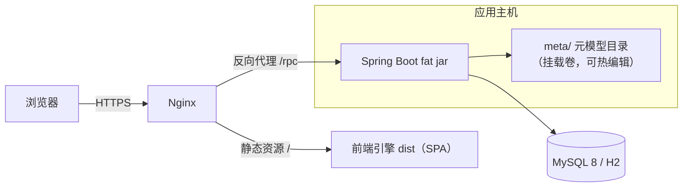

- 后端单 jar 部署，`meta/` 目录位置可配置（默认外置 `../meta`，可由配置指定绝对路径）；
- 浏览器使用同一来源访问静态资源、`/rpc` 和 `/api/**`；可由后端单 JAR 托管，或由 Nginx 托管静态资源并反向代理接口；
- 开发环境通过 Vite 将 `/rpc` 与 `/api/**` 代理到后端，浏览器保持同源访问。

## 7. 出错处理设计

- **协议层**：非法 JSON → -32700；协议字段缺失 → -32600；
- **路由层**：method 不存在或格式非法 → -32601；
- **校验层**：参数/过滤条件/记录校验失败 → -32602 / -32001（含字段级明细，前端回显）；
- **数据层**：记录不存在 → -32002；唯一冲突 → -32003；
- **元模型层**：元数据不存在 → -32004；重载校验失败 → -32005（旧快照继续服务）；
- **兜底**：未捕获异常 → -32603，全链路结构化日志（含 method、耗时、快照版本）。

---

# 第二部分 详细设计

## 8. 后端包结构

以下为 `platform-server/src/main/java/com/platform/` 中的实际包与主要源码。元模型内容使用 Jackson `JsonNode` 保存，不为每个业务模型生成 Java 实体类。

```text
com.platform
├── PlatformApplication.java
├── meta
│   ├── MetaEngine.java / MetaSnapshot.java / Definitions.java
│   ├── Conditions.java / RelationPaths.java
│   └── DataBackfillRunner.java
├── rpc
│   └── RpcController.java / RpcDispatcher.java / RpcException.java
├── service
│   ├── CrudExecutor.java / ServiceOrchestrator.java
│   ├── ServiceCallLog.java / ServiceLogController.java
│   └── extension
│       └── ModelCrudHandler.java / ModelCrudContext.java / ModelCrudRegistry.java
├── custom
│   └── StudentCrudHandler.java
├── dao
│   └── DdlSynchronizer.java
├── auth
│   ├── AuthContext.java / AuthFilter.java / AuthController.java / AuthService.java
│   └── ApplicationAccess.java / RpcAuthorization.java / RowScope.java
├── attachments
│   └── AttachmentController.java / AttachmentService.java / MultipartErrorAdvice.java
├── demo
│   └── DemoDataInitializer.java
└── config
    └── WebConfig.java / SpaFallbackFilter.java
```

## 9. 元模型引擎详细设计

### 9.1 类图

下图对应实际 Java 类。文件加载、结构校验、语义校验及当前快照管理由 `MetaEngine` 内部方法完成，定义节点保存为 `JsonNode`。

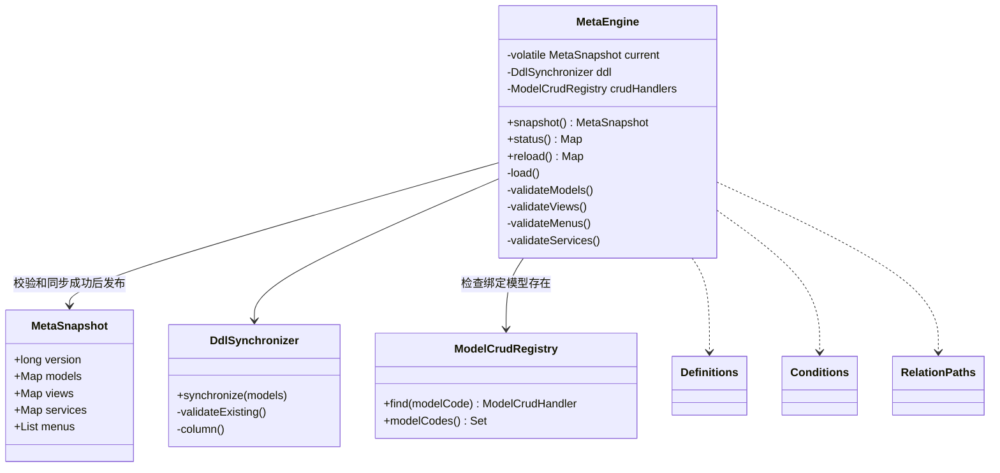

### 9.2 关键设计说明

| 设计点 | 决策 |
| ------ | ---- |
| 解析与校验 | Jackson 按文件解析 JSON，MetaEngine 检查必填节点、节点类型、字段约束及跨定义引用；汇总文件、路径与错误说明，校验失败时拒绝发布新快照 |
| 快照不可变 | `MetaSnapshot` 使用 record 和只读集合保存定义；消费者遵守不修改共享 JsonNode 的约定；`MetaEngine.current` 为 volatile 引用，校验与结构同步完成后一次替换 |
| 表同步范围 | 仅 `CREATE TABLE` 与 `ADD COLUMN`；不自动删除列或修改类型；不兼容的既有结构拒绝加载/重载并记录原因，人工迁移后再加载 |
| 菜单树构建 | 多文件菜单定义合并后按 order 稳定排序，形成树；叶子 `view` 在语义校验阶段已保证存在 |
| 审计字段 | DdlSynchronizer 添加系统列，CrudExecutor 写入实际操作者及维护版本；系统列不写入业务 fields 配置 |

## 10. RPC 网关与服务执行详细设计

### 10.1 类图

请求与响应由 `JsonNode` 和 Map 表达；错误码、消息及明细由 `RpcException` 携带，`RpcController` 负责转换成 JSONRPC 响应。

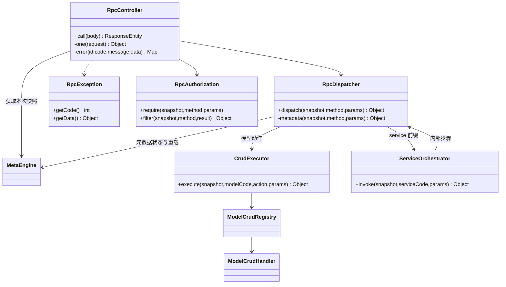

### 10.2 方法分发规则

1. method 为 `meta.*` 前缀 → `RpcDispatcher.metadata`，读取本次快照或调用 MetaEngine；
2. method 为 `service.*` 前缀 → 查 `MetaSnapshot.services`，命中则交由 `ServiceOrchestrator` 执行（见 §18）；
3. method 匹配 `<modelCode>.<action>` 且 action 属于支持的模型动作 → 校验模型已注册 → `CrudExecutor.execute` 在当前快照和事务边界内选择 Java 模型处理类或通用动作；
4. 其余 → -32601。

`meta.*`、`service.*` 与模型方法使用明确的命名空间。JSON 服务按 `service.<服务编码>` 调用；模型定制通过 Java CRUD 处理类注册，不依赖服务名称碰巧相同。所有分支沿用本次请求的同一份元模型快照。

### 10.2.1 Java 模型 CRUD 处理类

`com.platform.service.extension.ModelCrudHandler` 提供模型级扩展。开发者将其子类声明为 Spring `@Component`，通过 `modelCode()` 绑定一个已存在的模型，重写需要定制的动作。`ModelCrudRegistry` 按模型编码建立唯一注册表，重复或非法编码拒绝注册，未知模型绑定使元模型加载或重载失败。

处理类支持 `create`、`read`、`list`、`update`、`delete`、`batchCreate`、`batchDelete`、`adjust`、`transition`、`aggregate`、`related`。基类各方法默认执行通用动作，因此只重写 `create` 不影响该模型其他动作。

| 组件与方法 | 执行规则 |
| ---------- | -------- |
| `CrudExecutor.execute` | 统一执行入口；写操作先进入事务，再执行模型处理类；无处理类时执行通用动作 |
| `ModelCrudHandler` | 按动作分发到 Java 重写方法；作为 Spring 单例使用，请求状态保存在局部变量和上下文中 |
| `ModelCrudContext.proceed(params)` | 直接执行当前模型、当前动作的通用实现，避免再次进入同一个重写方法；`proceed()` 使用本次入参 |
| `ModelCrudContext.call(modelCode, action, params)` | 沿用当前快照进入另一模型或动作的完整执行入口；省略模型编码的重载调用当前模型其他动作 |
| `ModelCrudContext.model()` | 返回当前模型定义的副本，避免处理类修改共享元数据 |
| 默认批量动作 | 每条记录调用完整的 `create` 或 `delete` 入口；每批 1～200 条，外层事务统一提交或回滚 |

执行链按 `modelCode.action` 检测重入，允许同模型的 `create → list` 等业务检查，拒绝同一动作循环调用及超过 32 层的调用链。通用保存内部用于存在性、数据范围与版本校验的读取保持原生实现。

`com.platform.custom.StudentCrudHandler` 作为 Spring 组件绑定 `student`，在新增时去掉姓名两端空白后调用通用新增；普通接口、服务内调用与默认批量新增使用同一规则。学生字段约束及其他动作继续由通用实现执行。

HTTP 调用先执行应用权限校验，再进入处理类。通过 `super` 或 `context.proceed` 回落到通用实现时，继续执行字段校验、行级范围、乐观锁和模型约束。Java 处理类属于可信后端代码；自行编写 JDBC 查询或写入时，由开发者维护相同的数据范围与业务约束。通过上下文获取模型及调用 CRUD，避免处理类与 MetaEngine、CrudExecutor 形成构造依赖循环。

Java 处理类在编译、启动时注册；修改类文件后需重新编译并重启应用。`meta.reload` 只重载 JSON 定义，不编译或替换 Java 实现。

### 10.3 数据访问实现

`CrudExecutor` 负责通用 CRUD、过滤条件、排序、主键生成及参数化 SQL；`DdlSynchronizer` 负责 H2/MySQL 结构映射、已有结构检查及增量同步。数据库访问统一使用 Spring `JdbcTemplate`，写事务使用 `TransactionTemplate`。

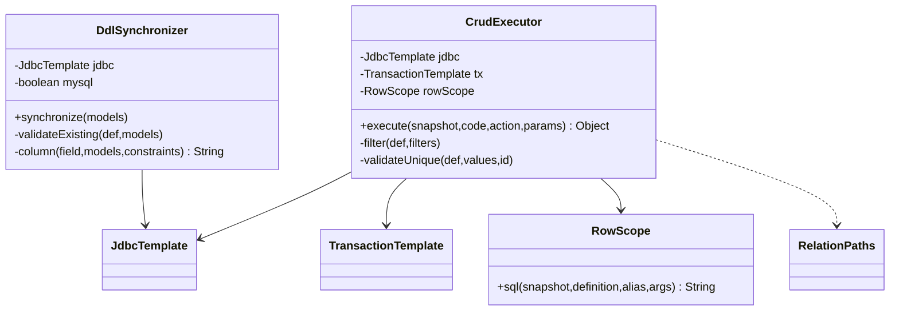

**安全要点**（对应需求 NFR-02 / FR-CRUD-09）：

- `CrudExecutor.filter` 仅接受模型中 `searchable=true` 的字段与支持的操作符。
- 表名、列名和排序字段从已校验的模型定义匹配，通过 `Definitions.q` 校验标识符后引用；条件值使用 SQL 占位符与参数列表传入 JdbcTemplate。
- 更新、删除及关联读取结合 `RowScope` 的服务端 SQL 条件；写入同时校验版本与模型约束。
- 自增主键取数据库生成键；UUID 与单实例雪花式编号在 CrudExecutor 内按 `idType` 生成。

## 11. 关键流程时序图

### 11.1 应用启动：元模型加载

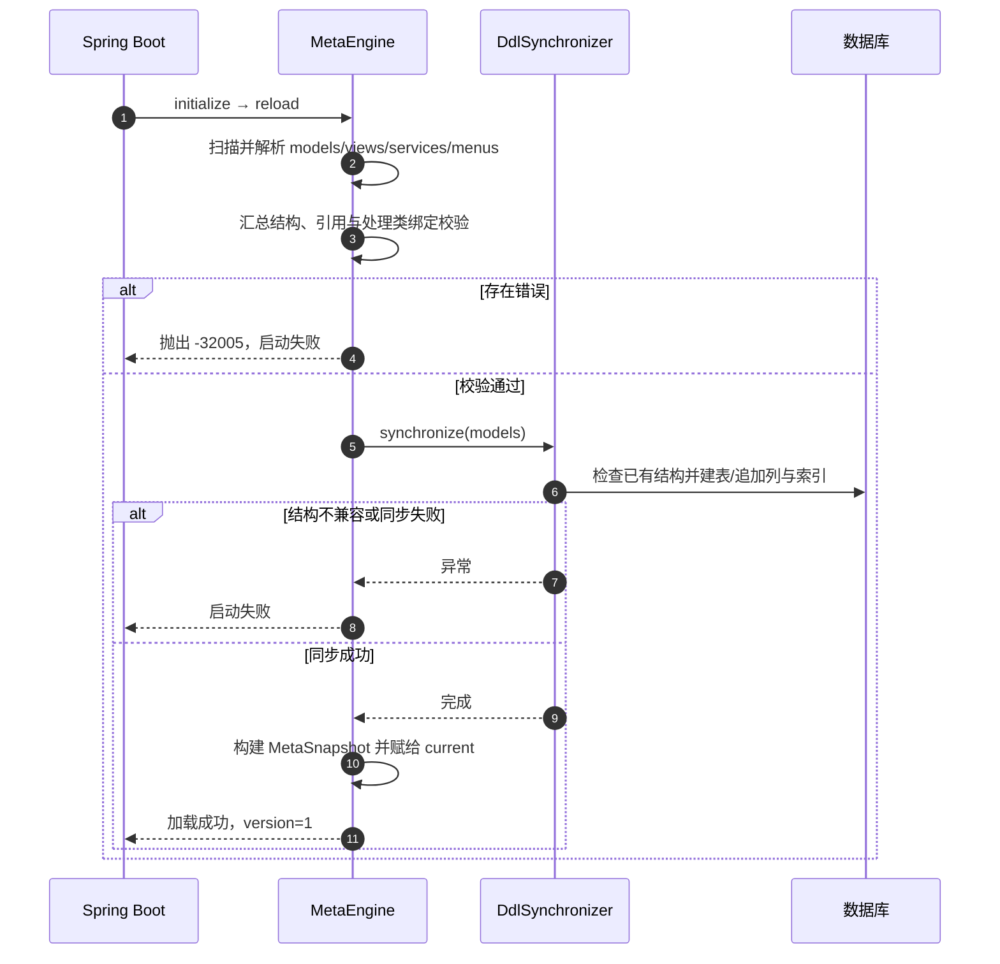

### 11.2 列表页访问（元数据 + 数据）

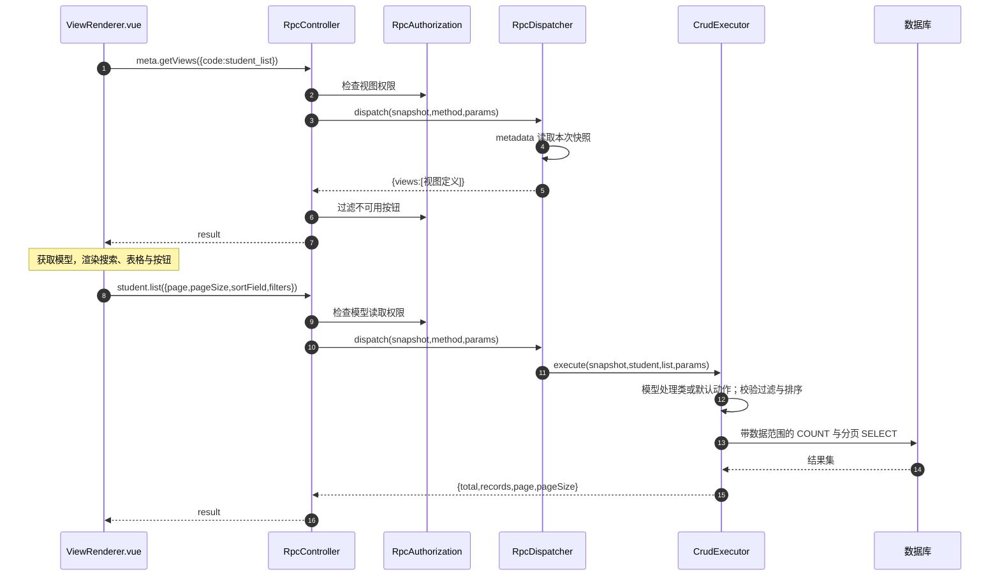

### 11.3 创建数据（student.create）

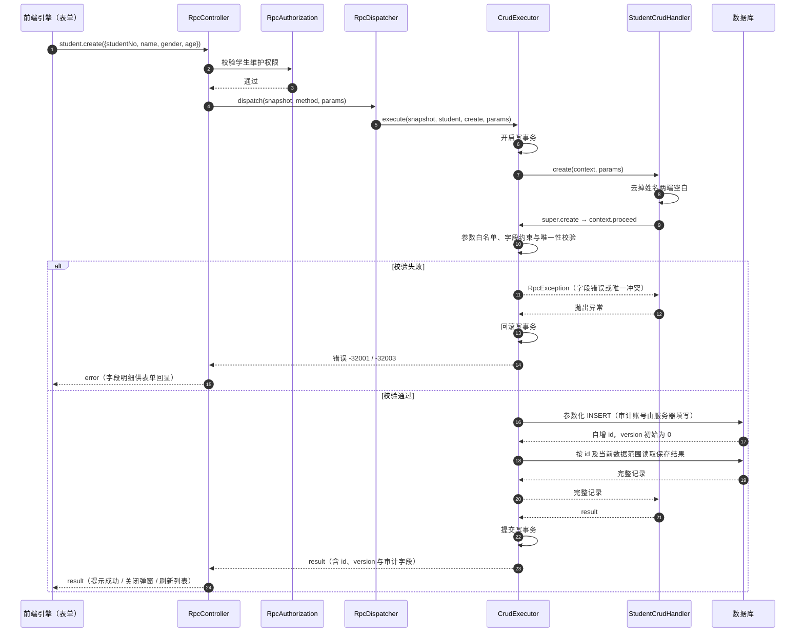

通过已认证会话向 `POST /rpc` 提交 JSONRPC 请求，写请求携带有效 CSRF 令牌。使用未占用学号的新增示例如下：

```json
{
  "jsonrpc": "2.0",
  "id": 1,
  "method": "student.create",
  "params": {"studentNo": "S-DEMO-001", "name": "  王同学  ", "gender": "F", "age": 20}
}
```

响应的 `result` 为保存后的完整学生记录，`name` 为“王同学”，`studentNo` 保持传入值；包含生成的 `id`、初始 `version:0` 及审计字段。缺少学号或姓名、姓名仅含空白时返回 `-32001`；学号冲突返回 `-32003`。

### 11.4 元模型热更新（meta.reload）

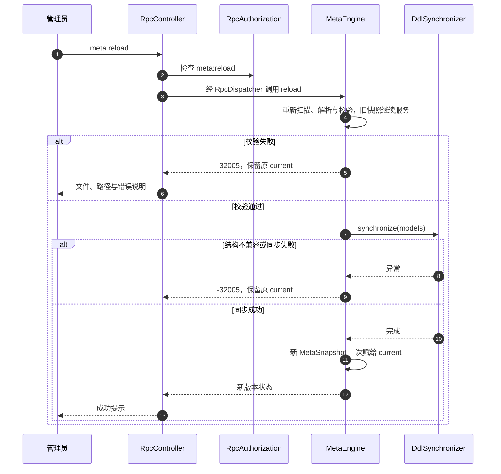

## 12. 关键流程活动图

### 12.1 元模型加载与校验活动图

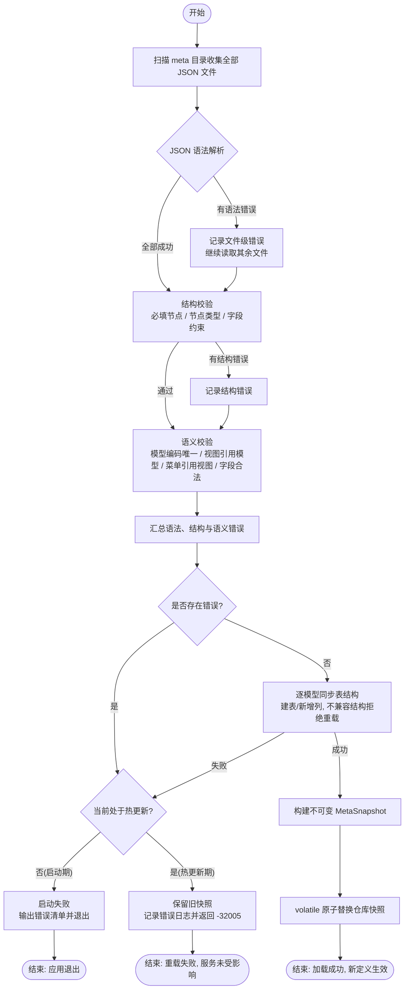

### 12.2 create 服务执行活动图

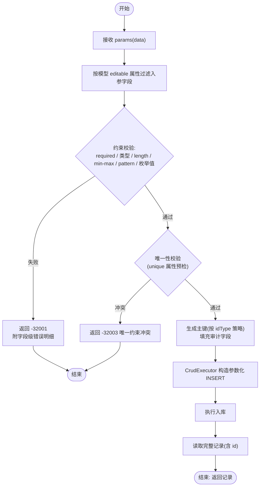

### 12.3 前端按钮动作调度活动图

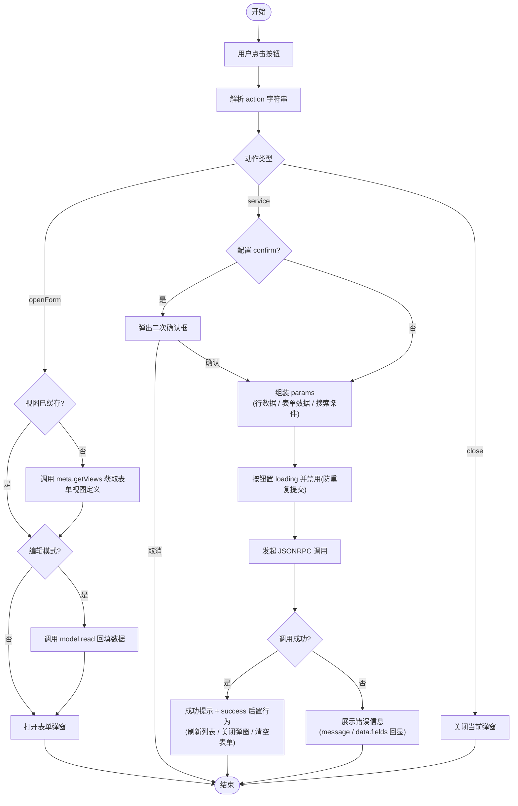

## 13. 元模型生命周期状态图

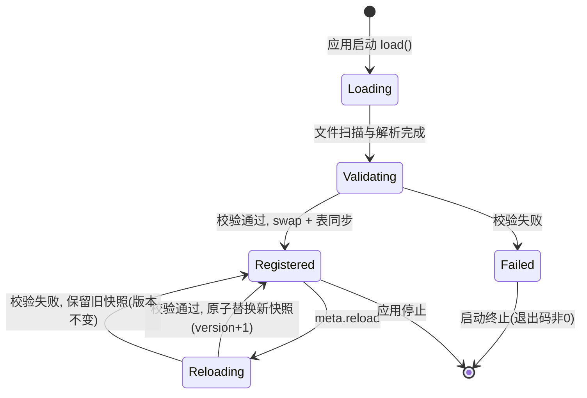

| 状态 | 含义 |
| ---- | ---- |
| Loading / Validating | 扫描解析中 / 校验中（启动期或重载期） |
| Registered | 快照已注册对外服务（运行期稳定态） |
| Reloading | 重载进行中，**旧快照持续提供服务** |
| Failed | 启动期校验失败（仅启动期存在） |

## 14. 前端引擎详细设计

### 14.1 组件结构

下图使用 `platform-web/src/` 下的实际文件名；列表逻辑位于 ViewRenderer，表单由 FormRenderer 渲染。

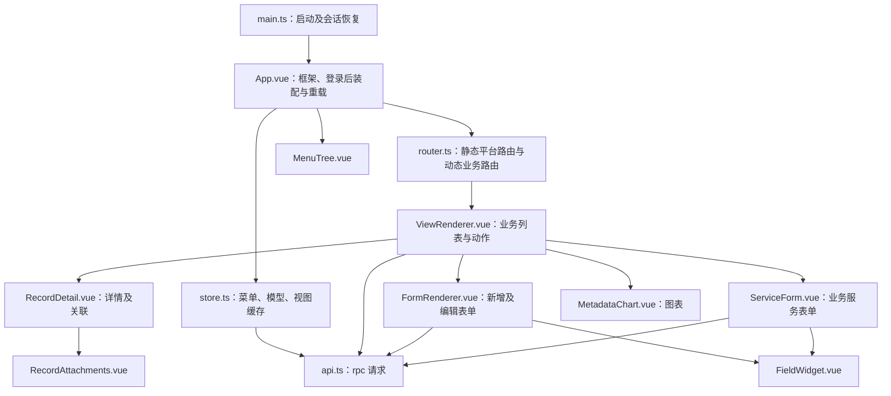

### 14.2 核心模块职责

| 文件 / 导出 | 职责 |
| ----------- | ---- |
| `api.ts` / `rpc` | 封装 `POST /rpc`、请求编号、CSRF 请求头、响应错误与未登录事件 |
| `store.ts` / `useMetaStore` | 菜单与状态刷新；视图、模型请求以 Promise 缓存，失败可重试，刷新后清空缓存 |
| `views/ViewRenderer.vue` | 读取视图和模型，渲染搜索、列表、分页、行选择及业务按钮，打开表单和详情 |
| `components/FieldWidget.vue` | 按字段类型或显式 widget 选择控件；提供枚举、引用选择及输入约束 |
| `views/ViewRenderer.vue`、`components/FormRenderer.vue` | 按钮确认、参数映射、调用、加载状态和成功后的关闭/刷新等动作 |
| `components/FormRenderer.vue` | 新增或编辑模式；编辑时携带 id、version 并调用 update |
| `components/ServiceForm.vue` | 按服务参数定义渲染业务表单，维护业务请求编号并展示声明的结果字段 |
| `router.ts` / `syncRoutes` | 根据菜单移除旧业务路由并注册新路由；平台管理路由静态保留 |
| `router.ts` / `beforeEach` | 未登录及首次改密时跳登录入口，平台权限不足时跳工作台 |
| `App.vue` / `enter`、`reload` | 登录后加载元数据与动态路由；重载成功后刷新缓存、同步路由并处理失效页面 |

### 14.3 控件推断矩阵（FieldWidget.vue）

| 字段 type | 默认 widget | 说明 |
| --------- | ----------- | ---- |
| string | input | 有 length 上限时前端 maxlength |
| text | textarea | |
| integer / decimal | number | min/max → 控件范围 |
| boolean | switch | |
| date | date-picker | |
| datetime | datetime-picker | |
| enum | select | options 来自字段定义 |
| ref | select(远程) | 选项来自 `<ref 模型>.list` 服务 |
| 显式 widget 声明 | 以声明为准 | input / textarea / number / select / radio / date / datetime / switch |

### 14.4 视图渲染流程（列表视图）

1. `MetaStore.getView(code)` → 未命中则 `meta.getViews` 拉取并缓存；
2. 按 `view.search.fields` 渲染搜索表单（字段名、控件、操作符 op 隐含在视图定义中）；
3. 按 `view.table.columns` 渲染表格列（enum 字段显示 label）；
4. 首次加载即调用 `<model>.list`（page=1, pageSize=pagination.pageSize），搜索/翻页/排序均重建 filters 参数；
5. 渲染按钮组，由 ViewRenderer.vue 或 FormRenderer.vue 处理确认、参数映射和调用。

列表业务按钮使用当前行、搜索或表单上下文；记录维护通过单条操作及显式业务服务完成，不提供通用批量新增、删除或更新的页面入口。

## 15. 设计与需求追踪矩阵

| 需求编号 | 设计落点 |
| -------- | -------- |
| FR-MODEL / FR-FIELD | MetaEngine、Definitions、JsonNode 模型与字段节点、校验约定（附录 A） |
| FR-ENGINE | MetaEngine / MetaSnapshot / DdlSynchronizer（§9）、状态图（§13） |
| FR-RPC | RpcController / RpcDispatcher / RpcException / 错误码表（§4.3、§10） |
| FR-CRUD | CrudExecutor / ModelCrudHandler / ModelCrudContext / ModelCrudRegistry、校验与参数化 SQL（§10） |
| FR-MENU | RpcDispatcher.metadata / RpcAuthorization，菜单 JsonNode（§9、§10） |
| FR-VIEW / FR-ACT | ViewRenderer.vue / FormRenderer.vue / FieldWidget.vue（§14） |
| FR-META | RpcDispatcher.metadata / MetaEngine（§10） |
| FR-DB | DdlSynchronizer、类型映射矩阵（§5.3）、索引策略（§5.4） |
| NFR-02 安全 | CrudExecutor 字段白名单与参数化 SQL（§10.3）、会话鉴权与 CSRF 校验 |
| NFR-06 可用性 | 快照原子替换 + 热更新失败回退（§9.2、§11.4） |
| FR-FE-10 / FR-FE-11 | `router.ts` / `store.ts` / `main.ts` / `App.vue`（§14.1、§14.2、§19） |
| FR-SVC-01 ~ 09 | JSON 服务定义 / `ServiceOrchestrator` / `t_service_idempotency`、分发规则（§10.2、§18） |
| FR-SCENE-01 ~ 09 | 状态机 / 关联反查 / 分账 / 事件流水 / 聚合 / `when` / `permission` / 乐观锁（§20） |

## 16. 附录 A：元模型结构与校验约定

元模型采用 JSON 文件描述，由 Jackson 解析为 JsonNode，MetaEngine 在加载与重载时执行结构和语义校验。

| 校验对象 | 结构与约束 |
| -------- | ---------- |
| 文件根节点 | 必须为对象；模型文件包含 `model` 和非空 `fields` 数组，视图、菜单、服务文件分别包含 `views`、`menus`、`services` 数组 |
| 编码与表名 | 模型、视图、服务编码为合法且不重复的标识符；表名合法、不重复且不占用平台保留名称 |
| 模型配置 | 名称为非空字符串；`idType` 为 `auto`、`uuid` 或 `snowflake`；`logicDelete`、`appendOnly`、`serviceOnly`、`attachments` 为布尔值；数据范围关联路径有效 |
| 字段定义 | 编码合法、不重复且不占用系统字段；名称非空；类型为 `string`、`text`、`integer`、`decimal`、`boolean`、`date`、`datetime`、`enum` 或 `ref` |
| 字段约束 | 布尔开关与数值约束类型正确；最小值不大于最大值；字符串长度和小数精度合法；正则表达式可编译；枚举选项非空且值不重复；引用模型存在 |
| 视图与菜单 | 视图类型、列表列与表单节点结构合法，引用的模型、字段、服务和视图存在；菜单编码不重复 |
| 服务与业务规则 | 服务步骤、参数和操作类型合法，引用的模型及服务存在；状态机与关联路径合法；图表字段、聚合方式及引用配置有效 |
| 错误反馈 | 汇总 `file`、`path`、`message` 返回 `-32005`；校验与数据库结构同步成功后发布新快照，重载失败时保留原快照 |

模型、视图、菜单和服务的配置示例分别见需求分析文档及本设计文档对应章节；校验规则由元模型引擎统一实现。

## 17. 附录 B：代码与文档交付清单

位置均相对项目根目录；Java 类位于 `platform-server/src/main/java/`。

| 交付物 | 实际位置 |
| ------ | -------- |
| 模型、视图、菜单及服务定义 | `meta/models/`、`meta/views/`、`meta/menus/main.json`、`meta/services/` |
| 元模型解析、校验与快照 | `com/platform/meta/MetaEngine.java`、`MetaSnapshot.java`、`Definitions.java` |
| RPC 入口、分发与异常 | `com/platform/rpc/RpcController.java`、`RpcDispatcher.java`、`RpcException.java` |
| H2 / MySQL 结构同步 | `com/platform/dao/DdlSynchronizer.java` |
| 建模与运行指南 | `docs/04-建模与运行指南.md` |
| 服务编排、幂等与日志 | `com/platform/service/ServiceOrchestrator.java`、`ServiceCallLog.java`、`ServiceLogController.java`；表 `t_service_idempotency`、`t_service_call_log` |
| CRUD、状态机、聚合及关联 | `com/platform/service/CrudExecutor.java`、`com/platform/meta/Conditions.java`、`RelationPaths.java` |
| 模型 Java 扩展与学生规则 | `com/platform/service/extension/`、`com/platform/custom/StudentCrudHandler.java` |
| 前端路由、缓存及装配 | `platform-web/src/router.ts`、`store.ts`、`main.ts`、`App.vue` |
| 业务视图、表单及图表组件 | `platform-web/src/views/ViewRenderer.vue`、`components/FormRenderer.vue`、`components/MetadataChart.vue` |
| 演示数据与初始化 | `meta/demo/seed.json`、`com/platform/demo/DemoDataInitializer.java` |
| 增量数据回填 | `meta/backfills/`、`com/platform/meta/DataBackfillRunner.java` |
| 验收与收尾材料 | `docs/05-迭代交付与验收记录.md`、`docs/06-完整功能验收清单.md`、`docs/07-视频演示脚本.md`、`docs/08-收尾任务清单.md` |

---

# 第三部分 业务与平台服务设计

> 本部分描述自定义服务、动态前端路由、生产业务、账号授权、附件、图表与服务日志的结构及执行规则。

## 18. 服务元模型详细设计

### 18.1 定位与分发

服务在本平台中是可独立声明的元模型。开发者在 `meta/services/*.json` 中声明参数、前置守卫、事务步骤与幂等策略；`MetaEngine` 校验后写入 `MetaSnapshot.services`，`RpcDispatcher` 按 `service.<服务编码>` 分发到 `ServiceOrchestrator`。查询、条件、受限循环与模型动作组成的业务使用 JSON 编排；需要任意 Java 算法或专用集成的模型动作通过 §10.2.1 的 Java 处理类扩展。JSON 服务内部调用模型动作时同样经过该处理类。

### 18.2 类图

服务、参数和步骤为 `MetaSnapshot.services` 中的 JSON 节点，不生成独立 Java 定义类。下图展示实际执行、事务和日志组件。

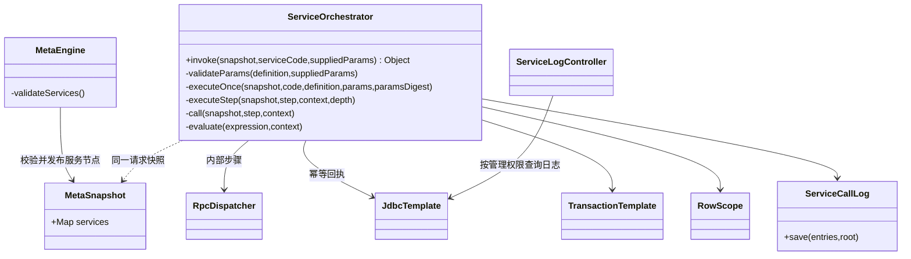

### 18.3 元模型结构约定与校验

| 字段 | 类型 | 说明 |
| ---- | ---- | ---- |
| `code` | string | 全局唯一，符合 `^[a-z][a-zA-Z0-9_]*$`；**不含点号**，避免与 `<model>.<action>` 冲突 |
| `transactional` | boolean | 默认 true；所有 steps 复用同一 `TransactionTemplate`，嵌套服务共用事务上下文 |
| `idempotencyKey` | string | 可选，必须指向已声明的 params 字段；调用方在同一业务请求的重试中保持键值与参数不变，服务以回执防止重复写入 |
| `params[]` | array | 复用 `FieldDefinition` 的 type / ref / required / min / max 语义 |
| `guards[]` / `steps[]` | array | `call` 目标 + `map` 路径表达式（`params.x` / `steps[i].result.x` / 常量） |
| `onError` | enum | `rollback`，事务失败时整体回滚 |

`MetaEngine.validateServices` 纳入 §12.1 的统一校验流程，检查项：

1. `call` 目标为已存在的模型动作或 `service.<服务编码>`，所有 `meta.*` 元数据及管理方法均禁止用于编排；
2. `map` 中的目标参数属于被调用动作或服务的入参白名单；
3. 服务调用图**无环**（DFS 检测嵌套调用）；
4. `idempotencyKey` 必须指向已声明的 params 字段；
5. 幂等服务启用事务；事务型与非事务型服务均不得调用 `meta.*`。

错误按 `file`、`path`、`message` 汇总：启动期阻断启动，热更新期保留旧快照并返回 -32005，与 §9.2 / §11.4 一致。

### 18.4 执行时序

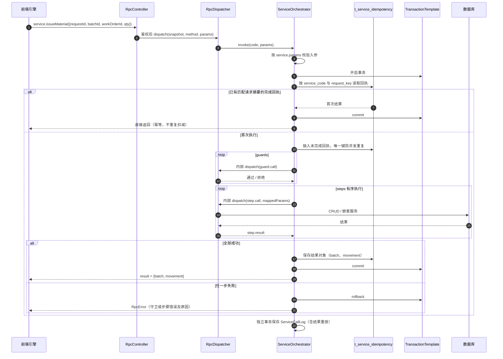

`issueMaterial` 的 `requestId`、`batchId`、`workOrderId`、`qty` 均在服务 `params` 中显式声明，其中 `qty` 为不小于 1 的整数。`requestId` 位于 JSONRPC 的 `params` 对象内，与协议层 `id` 分别使用。服务 `return` 将库存调整后的批次映射为 `batch`、新增库存流水映射为 `movement`；JSONRPC 响应将该对象置于 `result`。同一幂等键改参或并发占用返回 `-32012`。

### 18.5 组件职责与服务错误码

| 组件 | 职责 |
| ---- | ---- |
| MetaEngine | 扫描服务 JSON，统一结构与语义校验 |
| MetaSnapshot | models、views、services 与 menus 的原子快照 |
| RpcDispatcher | 元数据、service.* 与模型标准动作分发 |
| CrudExecutor | 事务内选择模型 Java 处理类或通用动作，提供参数化 CRUD、乐观锁、只追加、状态机、关联及聚合 |
| ModelCrudRegistry / ModelCrudHandler / ModelCrudContext | 模型绑定、动作重写、通用回落及同快照嵌套调用 |
| ServiceOrchestrator | 参数、守卫、条件步骤、受限循环、结果映射、事务及幂等 |
| ServiceCallLog | 调用上下文、逻辑事务关联及独立持久化 |

| code | 含义 |
| ---- | ---- |
| -32010 | 服务编排执行失败 |
| -32011 | 前置守卫拒绝 |
| -32012 | 幂等键冲突 |
| -32013 | 非法状态转移 |
| -32021 | 操作权限不足 |

## 19. 动态前端路由设计

业务菜单与路由从同一份已授权菜单元模型生成。登录、工作台、模型管理、用户与角色、服务调用日志及兜底页面在 `platform-web/src/router.ts` 中保留静态路由；业务路由由该文件的 `syncRoutes` 动态注册。

### 19.1 启动与登录装配时序

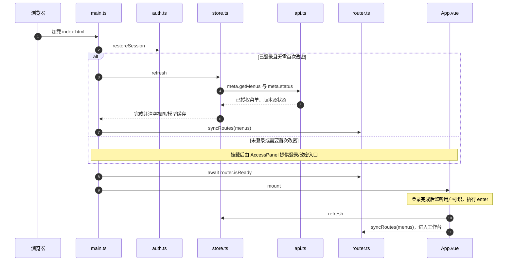

### 19.2 菜单到路由的映射

| 菜单节点 | 路由处理 |
| -------- | -------- |
| 目录节点 | 递归生成父路径，名称为 `menu:<code>`，使用 Vue Router 的 RouterView 承载子路由 |
| 叶子节点 | 名称为 `menu:<code>` 的 RouterView 父记录，空子路径名为 `view:<code>` 并使用 ViewRenderer |
| `:id` 子路径 | 名称为 `detail:<code>`，复用 ViewRenderer；页面详情和编辑通过对应对话框执行 |
| 路径与元信息 | 路径为父路径加菜单编码；`title`、`viewCode`、可选 `permission` 来自菜单 |
| `order` | 生成前按 order 排序，菜单展示保持相同顺序 |
| 重复 code | 元模型校验拒绝，防止动态路由名称冲突 |
| 未匹配路径 | 静态兜底 `/:pathMatch(.*)*` 显示 NotFound.vue |

学生菜单位于 `education` 下，生成路径 `/education/student`，其列表子路由可表示为：

```ts
{
  path: '',
  name: 'view:student',
  component: ViewRenderer,
  meta: { title: '学生管理', viewCode: 'student_list', permission: undefined }
}
```

该子记录位于路径为 `/education/student`、名称为 `menu:student` 的 RouterView 父记录中；可选 permission 原样取自菜单，不额外生成模型权限字符串。

### 19.3 元模型重载同步

1. `App.vue.reload` 调用 `meta.reload`，失败时显示错误并保留原有前端菜单和路由。
2. 成功后调用 `store.ts.refresh`，重新读取菜单、状态与版本，清空视图和模型 Promise 缓存。
3. `router.ts.syncRoutes` 执行已保存的动态路由移除函数，随后按新菜单重新注册全部业务路由；静态平台路由保留。
4. App.vue 重新解析当前路径；路径失效时跳转工作台，否则回到当前路径。
5. RouterView 的 key 包含路径与元模型版本，视图在版本变化后重新装载定义。

### 19.4 守卫与异常处理

| 场景 | 实际处理 |
| ---- | -------- |
| 未登录或需要首次改密 | router.beforeEach 将业务访问引导到 `/login`，App.vue 显示 AccessPanel |
| 已登录访问登录路径 | 跳转工作台 |
| 路由平台权限不足 | 根据 meta.permission 检查后跳转工作台；后端仍独立拒绝越权调用 |
| 页面刷新 | main.ts 恢复服务端会话并加载授权菜单后挂载；不依赖浏览器持久化的元数据缓存 |
| 并发读取相同模型或视图 | store.ts 复用同一 Promise；失败时删除缓存项以便重试 |
| 元数据或服务连接失败 | 页面显示错误和重连入口，不把错误响应缓存为成功定义 |
| 未知路径 | NotFound.vue 提供兜底展示 |
| 页标题 | App.vue 从当前路由 meta.title 显示标题，菜单根据当前路径高亮 |

## 20. 生产场景支撑能力矩阵

> 上层管理系统（如电脑装配生产系统）的业务流程优先使用元模型通用能力表达；专用算法或集成逻辑通过模型 Java 处理类扩展。下表列出可供各模型按需复用的平台能力。

### 20.1 能力矩阵

| 业务场景 | 元模型扩展 | 设计落点 | 需求编号 |
| -------- | ---------- | -------- | -------- |
| 零件损坏处置、不良品流转、工单推进 | `stateMachine: { field, initial, transitions: [{ from, to, guard }] }` | `CrudExecutor.transition` + `Conditions` | FR-SCENE-01 |
| 库存质量分账（良品/待检/不良/隔离） | `qualityStatus` 枚举 + `quantity` 库存数量 | `CrudExecutor.filter` 按 qualityStatus 过滤；服务守卫读取库存数量 | FR-SCENE-02 |
| 整机 SN 反查零件批次（追溯/召回） | `ref` 扩展为 `relations: [{ code, name, target, paths }]` | `CrudExecutor.related` + `RelationPaths` | FR-SCENE-03 |
| 领料不超扣、返工一增一减 | `version` 乐观锁 + 服务事务编排 | `CrudExecutor` 的 `WHERE version = ?` + `ServiceOrchestrator` | FR-SCENE-04 |
| 检验/返工/审批历史只追加 | `appendOnly: true` + `t_state_event` 事件流水 | `CrudExecutor` 拦截 update/delete；状态机自动写事件 | FR-SCENE-05 |
| 不良率、直通率、返工工时看板 | `aggregate` 服务 + 视图 `chart` 组件 | `CrudExecutor.aggregate` + `MetadataChart.vue` | FR-SCENE-06 |
| 按状态显示或禁用按钮、字段 | 按钮/字段 `when` 条件表达式 | `ViewRenderer.vue` / `FormRenderer.vue` / `conditions.ts` | FR-SCENE-07 |
| 不同角色看到不同菜单与操作 | `permission` 声明 | `RpcAuthorization` 过滤 + `router.ts` 守卫 + 服务端鉴权 | FR-SCENE-08 |
| 业务重复提交、网络重试 | JSON 服务显式声明 `idempotencyKey` | `ServiceOrchestrator` + `t_service_idempotency` 回执与参数摘要 | FR-SCENE-09 |

### 20.2 业务元模型节点清单

| 扩展点 | 位置 | 兼容性 |
| ------ | ---- | ------ |
| `stateMachine`、`model.appendOnly` | 模型顶层 / model 节点，可选 | 未声明时不启用相应状态机或只追加规则 |
| `version` | 系统列 | 所有业务记录自动维护；更新和删除提交当前版本 |
| `relations` | 模型顶层命名路径数组，可选 | 未声明时仍可使用 ref 字段 |
| `when`、`permission`、`chart` | view.button / view.field / view 节点，可选 | 同上 |
| `services` | 独立 `meta/services/*.json` | 引擎按目录扫描并统一注册 |
| `aggregate`、`transition` | 引擎内置服务 | 无需元模型声明 |

### 20.3 示例：不良处置状态机与业务守卫

以下摘自 `meta/models/defect_record.json` 的模型配置、状态字段和转移定义；批次、数量、原因等业务字段见该模型完整文件。

```json
{
  "model": {
    "code": "defect_record",
    "name": "不良处置",
    "table": "t_defect_record",
    "serviceOnly": true,
    "attachments": true
  },
  "fields": [
    {
      "code": "status", "name": "处置状态", "type": "enum",
      "editable": true, "listable": true, "searchable": true,
      "options": [
        {"value": "PENDING", "label": "待处置"},
        {"value": "ISOLATED", "label": "已隔离"},
        {"value": "REWORK", "label": "返工中"},
        {"value": "RECHECK", "label": "待复检"},
        {"value": "CLOSED", "label": "已关闭"},
        {"value": "RETURNED", "label": "已退货"},
        {"value": "SCRAPPED", "label": "已报废"},
        {"value": "CONCESSION", "label": "让步接收"}
      ]
    }
  ],
  "stateMachine": {
    "field": "status",
    "initial": "PENDING",
    "transitions": [
      {"from": "PENDING", "to": "ISOLATED"},
      {"from": "ISOLATED", "to": "REWORK"},
      {"from": "REWORK", "to": "RECHECK"},
      {"from": "RECHECK", "to": "CLOSED"},
      {"from": "RECHECK", "to": "REWORK"},
      {"from": "ISOLATED", "to": "RETURNED"},
      {"from": "ISOLATED", "to": "SCRAPPED"},
      {"from": "ISOLATED", "to": "CONCESSION"}
    ]
  }
}
```

处置单允许按声明的状态推进，因此不声明 `appendOnly`；检验、返工履历等事件记录另行采用只追加模型。非法转移返回 `-32013`，每次合法转移自动向 `t_state_event` 写入模型、记录编号、操作者、时间、前后状态及原因。

模型转移的可选 `guard` 仅支持布尔值或当前记录字段与字面量的比较，不执行服务名、JavaScript 或自由脚本。库存、返工数量等跨模型业务条件由 `meta/services/production.json` 中的显式服务 `guards` 检查。例如 `submitForRecheck` 的首个守卫为：

```json
{
  "call": "defect_record.read",
  "map": {"id": "params.defectId"},
  "condition": {"left": "result.status", "op": "eq", "right": {"const": "REWORK"}},
  "message": "处置单不在返工状态"
}
```

该服务随后聚合对应返工数量并要求其等于处置单的不良数量，全部守卫通过后，携带读取到的 `version` 调用 `defect_record.transition` 转入 `RECHECK`。普通业务账号通过已授权业务服务推进服务专用模型，管理员按其管理权限执行维护。

### 20.4 设计原则与证据链

业务场景优先复用元模型配置和通用能力（状态机、关联、聚合、事务及幂等）；需要专用 Java 算法或集成逻辑时，通过模型 CRUD 处理类定制所需动作，并复用通用校验与保存。各能力通过 §15 追踪矩阵关联《需求分析文档》中的 FR 与 AC，形成“题目要求 → 需求条目 → 设计落点 → 验收用例”的可追溯关系。验收范围以已声明的接口、页面入口和业务边界为准。

---


---


## 21. 身份认证、用户与角色设计

### 21.1 组件与存储

`AuthFilter` 识别受保护的 `/rpc` 与 `/api/**` 请求，解析 HttpOnly 的 `MDD_SESSION` Cookie，并把服务器验证的身份写入 `AuthContext`。每次请求结束清理线程身份。`AuthService` 负责账号、角色、密码摘要和会话；`AuthController` 提供 `/api/auth/**` 平台接口。业务数据与元数据使用 `/rpc`，账号、会话和附件使用 REST 接口。

| 表 | 内容 |
| -- | ---- |
| t_sys_user | 账号、姓名、密码摘要、角色集合、启用状态、首次改密标志、版本、逻辑删除状态、删除人及时间 |
| t_sys_role | 角色编码、名称、授权集合 |
| t_sys_session | 会话令牌摘要、用户、CSRF 令牌与有效期 |
| t_sys_audit | 操作人、操作名称、成功标志和时间 |
| t_sys_role_permission_backup | 权限配置转换时保留的角色配置副本 |

密码使用随机盐和 PBKDF2WithHmacSHA256（210000 次迭代）计算，长度 6～128 位，并包含字母及数字或符号。接口不返回明文或密码摘要。会话有效期为 8 小时。首次登录及密码重置后必须改密；改密、重置、停用和删除使相关会话失效。首次改密状态仅允许访问账号信息、改密和退出接口。

### 21.2 用户逻辑删除与角色约束

`DELETE /api/auth/users/{id}?version=...` 在事务内校验管理权限、用户状态和版本，设置 deleted、deleted_at、deleted_by，禁用用户、递增版本、删除会话并写审计。正常列表、身份验证、编辑和重置仅接受未删除用户。账号唯一约束覆盖已删除用户，历史 created_by/updated_by 与业务数据不改写。用户管理不提供恢复接口。

账号名为 `admin` 或拥有 `admin` 角色的账号不允许在管理页面被编辑、重置或删除；本人可从修改密码入口修改自己的密码。禁止删除当前登录账号。`admin`、`modeler`、`operator`、`viewer` 四个内置角色均禁止删除，`admin` 角色同时禁止编辑。自定义角色仍被未删除用户引用时禁止删除，停用用户计入引用检查，已删除用户不阻止删除角色；解除引用后才允许删除自定义角色。

### 21.3 接口与安全边界

| 接口 | 用途 |
| ---- | ---- |
| POST /api/auth/login、POST /api/auth/logout、GET /api/auth/me | 登录、退出及身份查询 |
| POST /api/auth/password | 本人修改密码 |
| GET/POST /api/auth/users | 查询、新建与编辑用户 |
| POST /api/auth/users/{id}/password | 重置密码 |
| DELETE /api/auth/users/{id}?version=... | 用户逻辑删除 |
| GET/POST /api/auth/roles、DELETE /api/auth/roles/{code} | 角色维护 |
| GET /api/auth/applications | 可授权应用和能力清单 |

写请求校验来源及 `X-CSRF-Token`。登录具备失败次数限制。账号、会话和密码信息不进入自定义服务日志。平台管理接口与业务应用分别校验权限，前端隐藏不能替代服务端鉴权。

## 22. 应用授权与数据范围设计

`ApplicationAccess` 从菜单、视图、按钮、服务参数和引用字段推导应用能力。授权标记为 `app_<菜单编码>:view/edit/operate`，系统权限为 `meta:inspect`、`meta:reload`、`users:manage`、`data:scopeAll`。角色页面按应用展示访问、编辑及业务操作，并在同页设置数据范围和系统权限，不提供独立业务补充权限。编辑和操作授权以应用访问为前提，受保护的服务业务模型不能由普通用户绕过服务直接写入。

`RpcAuthorization` 在分发前检查业务调用，在元数据响应中过滤菜单、视图及按钮；前端按返回菜单生成路由。用户多角色权限取并集；任一角色含 data:scopeAll 即获得全部数据范围。角色配置在每次认证请求中解析。

`RowScope` 根据模型声明生成服务端 SQL 谓词：

```json
{"rowScope":{"creator":true}}
```

表示当前用户创建的记录；`{"rowScope":{"via":"workOrderId"}}` 沿 ref 引用继承上游归属。`allowUnassigned:true` 允许引用为空的共享记录。未声明 rowScope 的模型作为共享资料。链路不得循环且最多八层；范围过滤覆盖列表、详情、写入引用校验、关联与聚合，客户端 filters 只能缩小可访问集合。内部跨工单业务使用 internalOnly:true、systemScope:true，外部顶层调用禁止进入，审计保留实际操作者。

## 23. 附件与本地持久化设计

模型通过 `model.attachments:true` 开启记录附件。`AttachmentService` 校验应用能力、记录归属和有效性；`AttachmentController` 提供以下接口：

| 接口 | 用途 |
| ---- | ---- |
| GET /api/attachments?model=...&recordId=... | 活动附件列表 |
| POST /api/attachments?model=...&recordId=... | multipart 字段 file 上传 |
| GET /api/attachments/{id}/download | 鉴权下载 |
| DELETE /api/attachments/{id} | 附件逻辑移除 |

文件正文保存在配置的上传目录，以内部标识组织，不映射为公开静态目录。t_attachment_file 保存记录关联、名称、大小、内容类型、SHA-256 和删除信息，t_attachment_event 保存上传、下载及移除事件。单文件最大 10 MiB，每条记录最多 20 个活动附件；允许 png、jpg、jpeg、webp、pdf、txt、csv、docx、xlsx 扩展名。移除、下载和上传分别执行对应的应用及操作者检查；源记录或附件失效时禁止下载。数据库与上传目录共同构成持久化备份对象。

## 24. BOM、关联追溯与物料闭环设计

### 24.1 业务模型与服务

| 模型 | 作用 |
| ---- | ---- |
| product_bom、bom_item | 单层产品版本和装机位置明细 |
| work_order | 计划数量、生产状态及固定 BOM 版本 |
| part_batch、stock_movement | 质量分账、库存及只追加库存变更流水 |
| assembly_record、assembly_component | 整机 SN、当前在用零件及装机位置 |
| component_change | 新旧零件更换履历 |
| material_consumption | 初装对工单领料的核销记录 |
| defect_record、rework_record、quality_inspection | 不良处置、返工与批次数量检验 |
| machine_inspection | 逐台整机检验与直通率计算基础 |

`createBom/addBomItem/removeBomItem/publishBom` 维护草稿和发布；发布后的结构不可直接编辑。`createBomWorkOrder` 绑定已发布版本。`checkBomKit` 按计划数量检查齐套，限制每单最多 200 台、每版本最多 100 个位置。`registerAssembly/attachComponent` 校验 BOM 位置、种类、数量及同工单领料余额，写入初装核销而不再次扣减库存；工单版本更新串行化关键校验，避免超装。

`replaceComponent` 在同一事务中处理更换用料、不良退回、停用旧关联、启用新关联及履历。`materialBalance` 计算 BOM 工单未用领料余额；`returnUnusedMaterial` 校验工单未冻结、原批次为良品且无未结质量异常，再校验余额、归还库存并写退库流水，幂等请求不会重复增加库存。`registerDefect/submitForRecheck/submitRecheck` 处理冻结、返工、复检与放行；存在其他未结异常时不放行。

### 24.2 关联路径协议

模型顶层 `relations` 以 code、name、target 和 paths 描述可命名追溯查询。每条路径由 model、field、direction（in/out）及可选 filters 组成。`RelationPaths` 校验路径，`CrudExecutor.related` 生成参数化 JOIN；多个路径并集去重后分页。查询的起点、中间节点和目标记录均执行模型读取及数据范围约束。

```json
{"code":"current_batches","name":"当前零件批次","target":"part_batch","paths":[[{"model":"assembly_component","field":"assemblyId","direction":"in","filters":[{"field":"active","op":"eq","value":true}]},{"model":"part_batch","field":"batchId","direction":"out"}]]}
```

## 25. 图表与整机直通率设计

### 25.1 通用图表协议

列表视图的 chart 为最多六项的数组。每项声明 code、title、type（bar/line）、groupBy（1～4 项）、metrics（1～10 项）、ratios、series（1～4 项）及可选 firstBy。`MetaEngine.validateCharts` 校验字段存在、数值聚合类型、别名唯一、比例引用及显示系列。`MetadataChart` 调用所属模型 aggregate，渲染 SVG 柱状图或折线图、数值明细和汇总卡片；列表成功查询后的筛选和刷新标识驱动图表同步。

```json
{"code":"first_pass","title":"整机直通率","type":"bar","groupBy":["workOrderId"],"firstBy":"assemblyId","metrics":[{"op":"sum","field":"testedQty","as":"tested"},{"op":"sum","field":"passedQty","as":"passed"}],"ratios":[{"as":"rate","numerator":"passed","denominator":"tested"}],"series":[{"field":"rate","name":"直通率","percent":true}]}
```

比例为 (numerator-subtract)/denominator×100%，subtract 可省略；分母为零显示“—”。总比例基于汇总分子和分母计算，不取各分组百分比平均值。包含 avg 指标的图表不把各组平均值相加生成汇总卡片。结果按分组稳定排序，返回最多 1000 项；使用第 1001 项识别截断并返回 truncated 标记。

### 25.2 首次检验选择与授权

`machine_inspection` 以 assemblyId 关联整机、以 workOrderId 关联工单，记录 result、testedQty=1、passedQty=0/1、workHours 和说明，模型只追加并沿 assemblyId 继承数据范围。`inspectMachine` 从服务器读取整机所属工单，依据 PASS/FAIL 写对应通过数量，事务及幂等键防止同次提交产生重复检验。检验登记记录检测事实，不自动替代不良处置的冻结和放行流程。

aggregate 的可选 firstBy 必须为模型声明的标识字段。SQL 在已授权、未删除且标识非空的历史记录内使用 `ROW_NUMBER() OVER(PARTITION BY firstBy ORDER BY id ASC)`，取序号 1 后应用用户筛选和分组聚合。MySQL 8 与 H2 均使用该协议。筛选不会把后续复检提升为首次检验。

直通率分母为有首次检验的整机台数，分子为其中首次通过台数。第一次失败、第二次通过仍计首次失败；未检验整机不参与该指标。批次合格率按登记数量统计，重复复检分别计入，与整机直通率保持独立口径。

## 26. 服务调用日志设计

### 26.1 数据结构与调用上下文

`ServiceCallLog` 保存自定义服务执行证据；`ServiceOrchestrator` 维护请求线程内的调用栈及待写日志集合。每个实际进入编排的服务产生独立 trace_id；嵌套调用共享 root_trace_id，parent_trace_id 指向直接调用者。transaction_id 为平台生成的逻辑事务关联编号，共享事务时继承该编号，不表示数据库引擎内部事务号。

| 字段 | 含义 |
| ---- | ---- |
| trace_id、root_trace_id、parent_trace_id | 当前、根及上级调用编号 |
| transaction_id | 平台逻辑事务编号，非事务调用可为空 |
| actor、service_code | 服务器身份中的操作人、服务编码 |
| params_hash、param_names | 原始参数 SHA-256 摘要及排序后的参数名称，不保存参数原文 |
| request_key、replayed | 幂等键及是否使用已有结果 |
| cost_ms、outcome、error_code、created_at | 执行耗时、结果、错误码及写入时间 |

### 26.2 结果与持久化

结果包括 SUCCESS、FAILED、ROLLED_BACK、REPLAYED。最外层服务事务结束后统一写入本次调用链；共享事务中已完成的子服务在事务失败时标记 ROLLED_BACK，失败点保持 FAILED。命中幂等回执时标记 REPLAYED，不重复执行业务写入。日志保存使用 REQUIRES_NEW 独立事务，因此业务回滚后仍可排查；日志保存失败写服务器错误日志，不改变已提交业务的返回结果。

初始化按数据库元数据检测缺失列，只增加列，不删除或重建现有日志表；历史字段为空的记录继续可查。异常传播使用调用编号关联服务器异常日志。

### 26.3 管理查询

`GET /api/auth/service-logs` 提供 page、pageSize、service、actor、outcome、root、requestKey 参数，筛选值参数化且采用精确匹配。页大小为 1～100；页面默认 20。`ServiceLogController` 要求 users:manage，前端静态平台路由为 `/platform/service-logs`。页面提供列表、详情及根调用链查询，不提供编辑或删除业务日志的入口。

